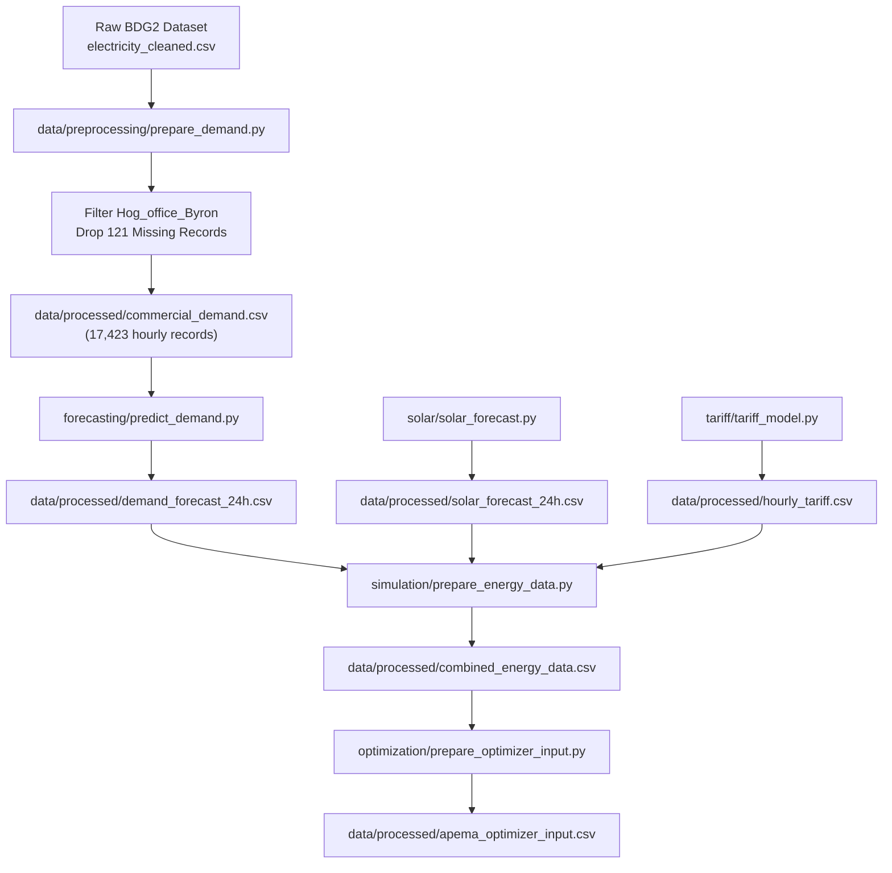
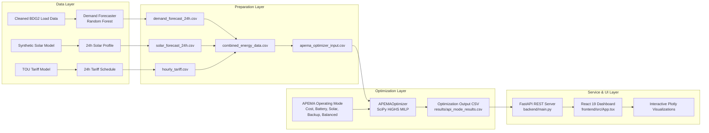

# APEMA – Master Project Understanding & Technical Audit Report

**Project Title:** Dynamic Price-Aware Solar, Battery & Grid Energy Management with Battery Life Optimization  
**System Name:** APEMA (Adaptive Price-Aware Energy Management Algorithm)  
**Report Date:** November 2026  
**Auditor Role:** Senior AI/ML Engineer, Energy Management Systems Developer, Optimization Engineer, and Full-Stack Developer  
**Status:** Inspection, Architecture Mapping, and Audit Completed (No Source Code Modified)

---

## 1. Project Overview

**APEMA (Adaptive Price-Aware Energy Management Algorithm)** is an intelligent, cyber-physical Energy Management System (EMS) designed for large commercial and institutional buildings equipped with on-site Solar Photovoltaic (PV) generation and a Behind-the-Meter (BTM) Battery Energy Storage System (BESS).

The primary function of APEMA is to determine the optimal, cost-effective, and degradation-conscious dispatch schedule for solar energy, battery charging/discharging, and grid electricity imports over a rolling or static 24-hour planning horizon. The platform bridges the gap between machine-learning-based building load forecasting, physical storage dynamics, time-varying electricity tariffs, and mathematical optimization using Mixed-Integer Linear Programming (MILP).

APEMA provides a full-stack implementation featuring:
- **Offline ML Forecasting:** Trained regression models for hourly electrical load forecasting.
- **Physical Modeling:** Realistic battery storage constraints, power conversion efficiencies, and empirical battery degradation accounting.
- **Deterministic MILP Optimizer:** Formulated with SciPy to balance operating costs, battery longevity, and solar utilization under multiple user-selectable operational profiles.
- **Microservice API:** FastAPI backend exposing operational modes and optimization dispatch execution.
- **Interactive Web Dashboard:** A dark-themed modern UI built with React 19, TypeScript, Tailwind CSS, and Plotly.js for interactive energy analytics, battery health inspection, and scheduling inspection.

---

## 2. Project Objectives

1. **Electricity Cost Minimization:** Dynamically schedule battery charging during low-tariff off-peak periods and discharge during high-tariff peak windows to capitalize on price arbitrage while satisfying continuous commercial building power demand.
2. **Solar PV Self-Consumption Maximization:** Prioritize local clean energy consumption and eliminate avoidable solar curtailment by allocating surplus solar generation to load or storage.
3. **Battery Cycling and Degradation Control:** Penalize battery throughput within the objective function using a replacement-cost-based degradation proxy, preventing unnecessary cycling when the tariff differential does not justify cell degradation.
4. **Physical Constraint and Longevity Safeguards:** Strictly enforce battery state-of-charge (SOC) operating bands (e.g., 20% to 90%), prevent simultaneous charging and discharging via binary decision variables, respect power converter C-rates, and enforce target terminal SOC reserves.
5. **Multi-Objective Operational Flexibility:** Support five user-selectable operating strategies (*Cost Saving*, *Battery Life*, *Solar Priority*, *Backup Priority*, and *Balanced*) that modulate objective weights and reserve thresholds according to facility priorities.
6. **Empirical Benchmarking:** Quantitatively benchmark APEMA's MILP schedules against established heuristic baseline rules (*Solar First*, *Price Only*, and *Degradation Aware*).

---

## 3. Complete Folder Structure

The audited project layout on the filesystem is detailed below (excluding virtual environments `.venv`, `node_modules`, `.git`, and `__pycache__` artifacts):

```text
c:\Users\duddu\Documents\APEMA project\
│
├── backend/
│   ├── __init__.py                                 # Package marker
│   └── main.py                                     # FastAPI application, CORS, and REST API endpoints
│
├── battery/
│   ├── battery_model.py                            # Physical battery simulation class (SOC, power limits, efficiencies)
│   ├── battery_system.py                           # Integrated battery + degradation system simulator
│   └── degradation_model.py                        # Empirical throughput and Equivalent Full Cycle (EFC) degradation estimator
│
├── data/
│   ├── analysis/
│   │   ├── dataset_documentation.txt               # BDG2 Hog_office_Byron summary documentation
│   │   ├── data_quality.py                         # Data quality verification (missing values, gaps, IQR outliers)
│   │   ├── system_sizing_check.py                  # PV and battery sizing analysis against peak building demand
│   │   └── visualize_demand.py                     # Matplotlib generation of daily, weekly, monthly, and peak demand profiles
│   ├── preprocessing/
│   │   └── prepare_demand.py                       # Extraction and cleaning of Hog_office_Byron from raw BDG2 dataset
│   ├── processed/
│   │   ├── apema_optimizer_input.csv               # 24-hour canonical input matrix for optimizer (demand, solar, tariff)
│   │   ├── combined_energy_data.csv                # 24-hour combined demand forecast, solar forecast, and tariff
│   │   ├── commercial_demand.csv                   # Cleaned 2-year hourly demand time series (17,423 records)
│   │   ├── demand_forecast_24h.csv                 # 24-hour ahead recursive load forecast
│   │   ├── hourly_tariff.csv                       # 24-hour time-of-use tariff rate schedule
│   │   └── solar_forecast_24h.csv                  # 24-hour synthetic solar irradiance and PV generation schedule
│   ├── raw/
│   │   ├── metadata/
│   │   │   └── metadata.csv                        # Git LFS pointer for BDG2 building metadata
│   │   ├── meters/
│   │   │   ├── cleaned/                            # Git LFS pointers for BDG2 cleaned meters (chilledwater, electricity, gas, solar, etc.)
│   │   │   ├── kaggle/                             # Git LFS pointer for kaggle meter data
│   │   │   └── raw/                                # Git LFS pointers for raw BDG2 meters
│   │   └── weather/
│   │       └── weather.csv                         # Git LFS pointer for BDG2 weather time series
│   └── simulation/                                 # Dedicated directory for simulation intermediate data
│
├── evaluation/
│   └── performance_analysis.py                     # Comparative performance bar chart generation for all strategies
│
├── forecasting/
│   ├── models/
│   │   └── demand_model.pkl                        # Serialized scikit-learn RandomForestRegressor model (126.8 MB)
│   ├── demand_forecast.py                          # Training pipeline for Random Forest demand forecaster
│   └── predict_demand.py                           # Recursive 24-hour horizon demand forecast generator
│
├── frontend/
│   ├── public/                                     # Static public assets
│   ├── src/
│   │   ├── assets/                                 # Icons and hero images
│   │   ├── App.css                                 # App-level styling
│   │   ├── App.tsx                                 # Root dashboard container, state management, API client
│   │   ├── BatteryAnalysis.tsx                     # Component: Charging/discharging energy, EFC, degradation chart
│   │   ├── BatterySOC.tsx                          # Component: Visual battery level gauge & state indicator
│   │   ├── ElectricityCostAnalysis.tsx             # Component: Tariff cost breakdown, scatter plots, peak cost cards
│   │   ├── EnergyCharts.tsx                        # Component: 2x2 grid of time-series line and bar charts
│   │   ├── EnergyScheduling.tsx                    # Component: 5 detailed operational schedules and stacked balance
│   │   ├── GridDependencyAnalysis.tsx              # Component: Self-sufficiency metrics, donut charts, grid import timeline
│   │   ├── GridMonitoring.tsx                      # Component: Peak grid import, dependency gauge, cost summary
│   │   ├── index.css                               # Tailwind directives and global theme styles
│   │   ├── main.tsx                                # React DOM root entry point
│   │   ├── SolarAnalysis.tsx                       # Component: Solar generation vs utilization, curtailment donut chart
│   │   └── SolarIndicator.tsx                      # Component: Solar PV generation and utilization overview
│   ├── package.json                                # Node dependencies (React 19, Plotly.js, Tailwind CSS 4)
│   ├── tsconfig.json                               # TypeScript configuration
│   ├── tsconfig.app.json                           # TypeScript client app configuration
│   ├── tsconfig.node.json                          # TypeScript node tooling configuration
│   └── vite.config.ts                              # Vite bundler configuration with Tailwind plugin
│
├── optimization/
│   ├── analyze_mode_schedules.py                   # Schedule inspector: hours charging, discharging, idle, average SOC
│   ├── apema_modes.py                              # Parameter definitions for the 5 APEMA operating modes
│   ├── apema_optimizer.py                          # Core MILP optimization mathematical model using SciPy
│   ├── baseline_strategies.py                      # Heuristic rule-based dispatchers (Solar First, Price Only, Degradation Aware)
│   ├── compare_all_strategies.py                   # Multi-strategy benchmark aggregator and SOC-adjusted cost analyzer
│   ├── compare_apema_modes.py                      # Automated batch execution of the 5 APEMA modes
│   ├── degradation_settings.py                     # Cost and cycle constants for battery degradation economics
│   ├── prepare_optimizer_input.py                  # Pipeline step converting combined energy data to optimizer format
│   ├── test_apema_modes.py                         # Sanity assertions validating APEMA mode configuration dictionaries
│   ├── validate_apema.py                           # Engineering constraint validation suite for APEMA mode results
│   ├── validate_baselines.py                       # Engineering constraint validation suite for baseline results
│   ├── validate_degradation.py                     # Battery health and degradation metric validation
│   └── validate_optimization.py                    # Physical power balance and bounds verification script
│
├── results/
│   ├── plots/                                      # Rendered Matplotlib PNG figures (demand overview, costs, SOC, etc.)
│   ├── all_strategy_comparison.csv                 # Metrics table comparing 5 APEMA modes vs 3 baseline strategies
│   ├── apema_mode_comparison.csv                   # Metrics table comparing the 5 APEMA modes
│   ├── apema_optimization_results.csv              # Standalone single-run 24-hour optimizer schedule output
│   ├── api_backup_priority_results.csv             # API execution output for Backup Priority mode
│   ├── api_balanced_results.csv                    # API execution output for Balanced mode
│   ├── api_battery_life_results.csv                # API execution output for Battery Life mode
│   ├── api_cost_saving_results.csv                 # API execution output for Cost Saving mode
│   ├── api_solar_priority_results.csv              # API execution output for Solar Priority mode
│   ├── backup_priority_results.csv                 # Batch script output for Backup Priority mode
│   ├── balanced_results.csv                        # Batch script output for Balanced mode
│   ├── battery_life_results.csv                    # Batch script output for Battery Life mode
│   ├── cost_saving_results.csv                     # Batch script output for Cost Saving mode
│   ├── degradation_aware_results.csv               # Baseline output for Degradation Aware heuristic
│   ├── price_only_results.csv                      # Baseline output for Price Only heuristic
│   ├── solar_first_results.csv                     # Baseline output for Solar First heuristic
│   └── solar_priority_results.csv                  # Batch script output for Solar Priority mode
│
├── simulation/
│   └── prepare_energy_data.py                      # Joins 24h demand, 24h solar, and hourly tariff on hour index
│
├── solar/
│   ├── solar_forecast.py                           # 24-hour solar generation forecast generator using synthetic irradiance
│   └── solar_model.py                              # Mathematical Solar PV generation model based on capacity and PR
│
├── tariff/
│   ├── tariff_analysis.py                          # Analysis of cheapest and peak tariff hours
│   └── tariff_model.py                             # 24-hour time-of-use electricity pricing definition and cost estimator
│
├── tests/                                          # Test directory (currently empty; unit testing suite pending)
├── .gitignore                                      # Git ignore rules for Python, virtual environments, and node_modules
├── ignore.txt                                      # Local developer operational scratch notes
├── main.py                                         # Standalone exploratory script for testing BDG2 raw data paths
└── README.md                                       # Comprehensive system documentation and execution guide
```

---

## 4. Technology Stack

| Layer | Component | Technology / Library | Version / Details | Purpose in APEMA |
|---|---|---|---|---|
| **OS & Shell** | Host OS | Microsoft Windows | Windows 11 / PowerShell | Execution environment |
| **Runtime** | Python Runtime | CPython | 3.12.x (in `.venv`) | Backend, modeling, and ML |
| **Runtime** | Node.js Runtime | Node.js & npm | Modern LTS | Frontend development environment |
| **Data Processing** | Data Manipulation | Pandas | 2.x | Time-series data cleaning, tabular alignment, CSV IO |
| **Numerical Math** | Array Computation | NumPy | 1.26 / 2.x | Vectorized matrix operations, linear algebra |
| **Optimization** | MILP Solver | SciPy (`scipy.optimize.milp`) | 1.13+ (`HiGHS` backend) | Mixed-integer linear programming dispatch |
| **Machine Learning**| Regressor | Scikit-learn | 1.4+ | Random Forest model for building demand forecasting |
| **Model Storage** | Serialization | Joblib | 1.4+ | Compressed disk serialization of trained `pkl` models |
| **Visualization** | Static Charts | Matplotlib | 3.8+ | Generation of high-resolution analysis PNGs |
| **Backend API** | Web Framework | FastAPI | 0.110+ | Asynchronous REST API microservice |
| **ASGI Server** | HTTP Server | Uvicorn | Standard | Asynchronous web server hosting the FastAPI backend |
| **Frontend UI** | SPA Framework | React.js | 19.3.1 | Reactive component-based dashboard interface |
| **Language** | Type Safety | TypeScript | 6.0.3 | Strict typing for API payloads and chart data |
| **Build Tool** | Bundler | Vite | 8.3.6 | Fast HMR development and production bundling |
| **Styling** | CSS Engine | Tailwind CSS | 4.3.5 (`@tailwindcss/vite`) | Utility-first responsive dark theme UI |
| **Charts** | Interactive Visuals| Plotly.js (`react-plotly.js`)| Plotly 4.2.0 / React-Plotly 4.1.0 | Interactive web-based energy graphs and schedules |

---

## 5. Dataset Information

### 5.1 Dataset Origin and Characteristics
The building energy consumption data originates from the **Building Data Genome Project 2 (BDG2)**, an open benchmark dataset produced by the BUDS Lab at the National University of Singapore.
- **Dataset Paper Reference:** Miller et al., *"The Building Data Genome Project 2, a open dataset of 3,053 energy meters from 1,636 buildings"*, Scientific Data, 2020.
- **Building Identifier:** `Hog_office_Byron`
- **Building Primary Use:** Commercial Office
- **Site Identifier:** `Hog`
- **Gross Floor Area:** 80,038.2 m²
- **Meter Analyzed:** Electricity (`electricity_cleaned.csv`)
- **Measurement Unit:** Hourly energy consumption in kilowatt-hours (**kWh** per hour). For an interval length $\Delta t = 1.0\text{ h}$, the numerical value of hourly energy consumption in kWh is mathematically and numerically equivalent to the average electrical power demand in kilowatts (**kW**).

### 5.2 Quality and Preprocessing Statistics
From `data/analysis/dataset_documentation.txt` and `data/analysis/data_quality.py`:
- **Temporal Span:** January 1, 2016, 00:00:00 to December 31, 2017, 23:00:00 (2 complete calendar years).
- **Nominal Hourly Records:** 17,544 records.
- **Missing Readings:** 121 missing values (0.69% of records).
- **Valid Preprocessed Records:** 17,423 records (saved to `data/processed/commercial_demand.csv`).
- **Data Integrity:** 0 duplicate timestamps; 0 negative values; 0 zero readings.
- **Outlier Detection:** 153 readings identified outside $1.5 \times \text{IQR}$ (predominantly summer peak chiller cooling surges).
- **Demand Statistics:**
  - Mean Hourly Demand: **951.95 kW** (kWh/h)
  - Standard Deviation: **193.82 kW**
  - Minimum Demand: **219.00 kW**
  - Maximum Peak Demand: **1,816.29 kW**

### 5.3 System Sizing Context
From `data/analysis/system_sizing_check.py`:
- Configured Solar PV Capacity: **100 kW** (5.51% of peak demand, 10.5% of average demand).
- Configured Battery Storage: **200 kWh / 50 kW** (Battery power covers 2.75% of peak demand; full capacity sustains average building load for only $200 / 951.95 \approx 0.21\text{ hours}$ or 12.6 minutes).
- **System Sizing Reality:** The building demand is an order of magnitude larger than the solar and storage resources. Consequently, the utility grid is the dominant energy source (>90% grid dependency), and the battery acts purely as a peak-shaving and price-arbitrage buffer rather than an islanded microgrid.

---

## 6. Data Processing Workflow

The data processing pipeline is implemented across `data/preprocessing/` and `simulation/`:



### Module Breakdown:
1. **`data/preprocessing/prepare_demand.py`**:
   - *Inputs:* `BDG2_Download/building-data-genome-project-2/data/meters/cleaned/electricity_cleaned.csv`
   - *Logic:* Filters building column `Hog_office_Byron`, casts timestamps, drops rows where demand is NaN, sorts chronologically.
   - *Outputs:* `data/processed/commercial_demand.csv`
2. **`simulation/prepare_energy_data.py`**:
   - *Inputs:* `demand_forecast_24h.csv`, `solar_forecast_24h.csv`, `hourly_tariff.csv`
   - *Logic:* Parses timestamps, extracts integer hour (0–23), performs an inner merge on `hour` across demand, solar, and tariff datasets.
   - *Outputs:* `data/processed/combined_energy_data.csv` (24 rows, 5 columns: `timestamp`, `predicted_demand`, `hour`, `solar_generation_kw`, `tariff_inr_per_kwh`).
3. **`optimization/prepare_optimizer_input.py`**:
   - *Inputs:* `data/processed/combined_energy_data.csv`
   - *Logic:* Normalizes column naming conventions into standardized optimizer keys: `demand_kwh`, `demand_kw` ($= \text{demand\_kwh} / 1.0$), `solar_kw`, and `tariff_inr_per_kwh`.
   - *Outputs:* `data/processed/apema_optimizer_input.csv`.

---

## 7. Demand Forecasting Workflow

Implemented in `forecasting/demand_forecast.py` and `forecasting/predict_demand.py`.

### 7.1 Model Architecture & Training
- **Model Type:** Scikit-learn `RandomForestRegressor(n_estimators=100, random_state=42, n_jobs=-1)`.
- **Target Variable:** $y_t = \text{demand}_t$ (kWh/h).
- **Engineered Features ($X$):**
  1. `hour`: Hour of day ($0, \dots, 23$).
  2. `day_of_week`: Day of week ($0 = \text{Monday}, \dots, 6 = \text{Sunday}$).
  3. `month`: Month of year ($1, \dots, 12$).
  4. `previous_hour`: Lag-1 demand $y_{t-1}$ (`demand.shift(1)`).
- **Split Strategy:** Strict chronological 80/20 train/test split (no lookahead leakage):
  - Training set: First 13,937 records (approx. Jan 2016 to Aug 2017).
  - Test set: Remaining 3,485 records (approx. Aug 2017 to Dec 2017).
- **Model Storage:** Pickled model dumped to `forecasting/models/demand_model.pkl` (file size: 126.8 MB).
- **Performance:** Mean Absolute Error (MAE) on test set is approximately **27.2 kWh** (relative error $\approx 2.85\%$).

### 7.2 24-Hour Recursive Inference
- Implemented in `forecasting/predict_demand.py`.
- Generates future forecast starting from `2018-01-01 00:00:00` for 24 hourly periods.
- Because true lag-1 demand is unavailable beyond $t=0$, inference runs **recursively**:
  $$\hat{y}_{t} = f\left(\text{hour}_t, \text{day}_t, \text{month}_t, \hat{y}_{t-1}\right)$$
  where $\hat{y}_0$ is initialized with the final observed historical reading from December 31, 2017.
- **Output:** Stored in `data/processed/demand_forecast_24h.csv`.

---

## 8. Solar Generation Workflow

Implemented in `solar/solar_model.py` and `solar/solar_forecast.py`.

### 8.1 Physical PV Model Formulation
The solar generation model calculates AC power output based on standard photovoltaic rating principles:
$$P_{\text{pv}}[t] = \min\left(P_{\text{pv}}^{\text{cap}}, \; P_{\text{pv}}^{\text{cap}} \times \frac{G[t]}{G_{\text{STC}}} \times \text{PR}\right)$$
where:
- $P_{\text{pv}}^{\text{cap}} = 100\text{ kW}$ (rated peak DC capacity under STC).
- $G[t]$ = Global solar irradiance at hour $t$ ($\text{W/m}^2$).
- $G_{\text{STC}} = 1000\text{ W/m}^2$ (standard test condition irradiance).
- $\text{PR} = 0.80$ (system performance ratio accounting for inverter efficiency, thermal derating, dirt, and wiring losses).

### 8.2 Profile Generation
- In `solar/solar_forecast.py`, an illustrative 24-hour diurnal solar irradiance vector is defined:
  $$\mathbf{G} = [0, 0, 0, 0, 0, 50, 150, 300, 500, 700, 850, 950, 1000, 950, 850, 700, 500, 250, 100, 20, 0, 0, 0, 0] \text{ W/m}^2$$
- Peak generation occurs at 12:00 PM: $100 \times (1000 / 1000) \times 0.80 = 80.0\text{ kW}$.
- Total daily generated solar energy: $\sum_{t=0}^{23} P_{\text{pv}}[t] \times 1\text{ h} = 648.0\text{ kWh}$.
- **Output:** Saved to `data/processed/solar_forecast_24h.csv`.
- **Limitation:** The profile is synthetically defined. No machine learning forecasting or historical solar irradiance data from BDG2 weather sensors is currently utilized.

---

## 9. Tariff Model

Implemented in `tariff/tariff_model.py` and analyzed in `tariff/tariff_analysis.py`.

### 9.1 Tariff Structure
The model applies a stepped Time-of-Use (TOU) electricity tariff schedule reflecting typical peak and off-peak rate structures (values in Indian Rupees per kWh, ₹/kWh):

| Hours (24-hour clock) | Tariff Category | Rate (₹/kWh) |
|---|---|---:|
| 00:00 – 05:00 (Hours 0–4) | Night Off-Peak | ₹4.00 |
| 05:00 – 07:00 (Hours 5–6) | Morning Shoulder | ₹4.00 – ₹5.00 |
| 07:00 – 08:00 (Hour 7) | Morning Peak Transition | ₹5.00 |
| 08:00 – 15:00 (Hours 8–14)| Daytime Normal | ₹6.00 |
| 15:00 – 17:00 (Hours 15–16)| Evening Pre-Peak | ₹7.00 |
| 17:00 – 20:00 (Hours 17–19)| Evening Super-Peak | ₹8.00 |
| 20:00 – 21:00 (Hour 20) | Evening Shoulder | ₹7.00 |
| 21:00 – 22:00 (Hour 21) | Night Shoulder | ₹6.00 |
| 22:00 – 23:00 (Hour 22) | Night Transition | ₹5.00 |
| 23:00 – 24:00 (Hour 23) | Night Off-Peak | ₹4.00 |

### 9.2 Economic Spread
- Minimum Tariff: ₹4.00/kWh (Hours 0, 1, 2, 3, 4, 23).
- Maximum Tariff: ₹8.00/kWh (Hours 17, 18, 19).
- Arbitrage Differential: $\Delta c = ₹8.00 - ₹4.00 = ₹4.00\text{/kWh}$.
- Output saved to `data/processed/hourly_tariff.csv`.
- **Limitation:** Rates are illustrative project assumptions. Official Tamil Nadu Generation and Distribution Corporation (TANGEDCO) High Tension Commercial Tariff (HT-III) involves maximum demand charges (kVA), time-differentiated slab surcharges, and power-factor incentives not modeled here.

---

## 10. Battery Model

Implemented in `battery/battery_model.py` and wrapped in `battery/battery_system.py`.

### 10.1 Specifications and Parameters
- **Nominal Energy Capacity ($C_{\text{batt}}$):** $200\text{ kWh}$.
- **Max Charging Power Limit ($P_{\text{ch}}^{\max}$):** $50\text{ kW}$ ($0.25\text{ C}$).
- **Max Discharging Power Limit ($P_{\text{dis}}^{\max}$):** $50\text{ kW}$ ($0.25\text{ C}$).
- **Operating SOC Limits:** $\text{SOC}_{\min} = 0.20$ ($20\%$), $\text{SOC}_{\max} = 0.90$ ($90\%$).
- **Initial State of Charge ($\text{SOC}_0$):** $0.50$ ($50\% \implies 100\text{ kWh}$).
- **Charging Coulombic / Converter Efficiency ($\eta_{\text{ch}}$):** $0.95$ ($95\%$).
- **Discharging Efficiency ($\eta_{\text{dis}}$):** $0.95$ ($95\%$).
- **Round-Trip Efficiency ($\eta_{\text{RTE}}$):** $\eta_{\text{ch}} \times \eta_{\text{dis}} = 0.95 \times 0.95 = 0.9025$ ($90.25\%$).

### 10.2 State Transition Equations
For discrete time interval $\Delta t = 1.0\text{ h}$:
1. **Charging Update:**
   $$E_{\text{batt}}[t] = E_{\text{batt}}[t-1] + \min\left(P_{\text{ch}}[t] \Delta t \eta_{\text{ch}}, \; \text{SOC}_{\max} C_{\text{batt}} - E_{\text{batt}}[t-1]\right)$$
2. **Discharging Update:**
   $$E_{\text{batt}}[t] = E_{\text{batt}}[t-1] - \frac{P_{\text{dis}}[t] \Delta t}{\eta_{\text{dis}}}$$
3. **State of Charge:**
   $$\text{SOC}[t] = \frac{E_{\text{batt}}[t]}{C_{\text{batt}}}$$

---

## 11. Battery Degradation Model

Implemented in `battery/degradation_model.py` and parameterized in `optimization/degradation_settings.py`.

### 11.1 Mathematical Formulation
The degradation framework uses an **Equivalent Full Cycle (EFC)** throughput proxy rather than a nonlinear electrochemical SEI-growth or Rainflow cycle-counting model.

1. **Energy Throughput ($\text{TP}$):**
   $$\text{TP}[t] = \left(P_{\text{ch}}[t] + P_{\text{dis}}[t]\right) \Delta t \quad [\text{kWh}]$$
2. **Equivalent Full Cycles ($\text{EFC}$):**
   One full cycle corresponds to discharging and charging the total nominal capacity ($2 \times C_{\text{batt}}$):
   $$\text{EFC} = \frac{\sum_{t} \text{TP}[t]}{2 \times C_{\text{batt}}}$$
3. **Capacity Loss / State of Health (SOH) Degradation Percentage:**
   Assuming a linear lifetime rating of $N_{\text{cycle}} = 4,000$ cycles to end-of-life (EOL):
   $$\text{Degradation } (\%) = \left(\frac{\text{EFC}}{N_{\text{cycle}}}\right) \times 100 = \left(\frac{\sum \text{TP}[t]}{2 \times C_{\text{batt}} \times N_{\text{cycle}}}\right) \times 100$$
4. **Economic Degradation Cost per kWh:**
   Derived from an assumed battery replacement capital expenditure of $\text{CapEx} = ₹100,000$:
   $$c_{\text{deg}} = \frac{\text{CapEx}}{2 \times C_{\text{batt}} \times N_{\text{cycle}}} = \frac{100,000}{2 \times 200 \times 4000} = ₹0.0625 \text{ per kWh throughput}$$

---

## 12. APEMA Optimization Mathematical Formulation

Implemented in `optimization/apema_optimizer.py` utilizing the `scipy.optimize.milp` interface with the **HiGHS** simplex/interior-point solver.

### 12.1 Decision Variables
For a planning horizon of $N$ hours ($t = 0, 1, \dots, N-1$; here $N=24$), the optimization vector $\mathbf{x} \in \mathbb{R}^{7N}$ consists of seven decision variables per hour:

| Variable | Symbol | Type | Lower Bound | Upper Bound | Description |
|---|---|---|---|---|---|
| $x_{0 \dots N-1}$ | $P_{\text{grid}}[t]$ | Continuous | $0$ | $+\infty$ | Grid power imported at hour $t$ (kW) |
| $x_{N \dots 2N-1}$ | $P_{\text{ch}}[t]$ | Continuous | $0$ | $P_{\text{ch}}^{\max} = 50$ | Battery charging power at hour $t$ (kW) |
| $x_{2N \dots 3N-1}$ | $P_{\text{dis}}[t]$ | Continuous | $0$ | $P_{\text{dis}}^{\max} = 50$ | Battery discharging power at hour $t$ (kW) |
| $x_{3N \dots 4N-1}$ | $P_{\text{curt}}[t]$ | Continuous | $0$ | $P_{\text{solar}}[t]$ | Curtailed solar generation at hour $t$ (kW) |
| $x_{4N \dots 5N-1}$ | $u_{\text{ch}}[t]$ | Binary ($\{0, 1\}$) | $0$ | $1$ | Indicator: $1$ if battery is charging, $0$ otherwise |
| $x_{5N \dots 6N-1}$ | $u_{\text{dis}}[t]$ | Binary ($\{0, 1\}$) | $0$ | $1$ | Indicator: $1$ if battery is discharging, $0$ otherwise |
| $x_{6N \dots 7N-1}$ | $E_{\text{batt}}[t]$ | Continuous | $E_{\min}$ | $E_{\max}$ | Battery energy at the end of hour $t$ (kWh) |

where:
$$E_{\min} = \max\left(\text{min\_soc}, \text{reserve\_soc}\right) \times C_{\text{batt}}$$
$$E_{\max} = \text{max\_soc} \times C_{\text{batt}} = 0.90 \times 200 = 180\text{ kWh}$$

### 12.2 Objective Function
The objective is to minimize total operational expenditure:
$$\min_{\mathbf{x}} \; Z = \sum_{t=0}^{N-1} \Bigg( \underbrace{c_{\text{grid}}[t] P_{\text{grid}}[t] \Delta t}_{\text{Electricity Purchase Cost}} + \underbrace{c_{\text{deg}} w_{\text{deg}} \left(P_{\text{ch}}[t] + P_{\text{dis}}[t]\right) \Delta t}_{\text{Weighted Degradation Penalty}} + \underbrace{0.01 \cdot w_{\text{solar}} P_{\text{curt}}[t] \Delta t}_{\text{Solar Curtailment Penalty}} \Bigg)$$

### 12.3 Mathematical Constraints
1. **Power Balance Equality Constraint (for each $t \in [0, N-1]$):**
   $$P_{\text{grid}}[t] + P_{\text{dis}}[t] - P_{\text{ch}}[t] - P_{\text{curt}}[t] = P_{\text{demand}}[t] - P_{\text{solar}}[t]$$
   *(Physically: $P_{\text{grid}}[t] + (P_{\text{solar}}[t] - P_{\text{curt}}[t]) + P_{\text{dis}}[t] = P_{\text{demand}}[t] + P_{\text{ch}}[t]$)*
2. **Battery Energy Dynamics Constraint:**
   - At $t = 0$:
     $$E_{\text{batt}}[0] - \eta_{\text{ch}} \Delta t P_{\text{ch}}[0] + \frac{\Delta t}{\eta_{\text{dis}}} P_{\text{dis}}[0] = E_{\text{batt},\text{init}}$$
     where $E_{\text{batt},\text{init}} = \text{initial\_soc} \times C_{\text{batt}} = 0.50 \times 200 = 100\text{ kWh}$.
   - For $t \in [1, N-1]$:
     $$E_{\text{batt}}[t] - E_{\text{batt}}[t-1] - \eta_{\text{ch}} \Delta t P_{\text{ch}}[t] + \frac{\Delta t}{\eta_{\text{dis}}} P_{\text{dis}}[t] = 0$$
3. **Charging Big-M Capacity Limit (via Binary Variable):**
   $$P_{\text{ch}}[t] - P_{\text{ch}}^{\max} u_{\text{ch}}[t] \le 0$$
4. **Discharging Big-M Capacity Limit (via Binary Variable):**
   $$P_{\text{dis}}[t] - P_{\text{dis}}^{\max} u_{\text{dis}}[t] \le 0$$
5. **No Simultaneous Charge and Discharge:**
   $$u_{\text{ch}}[t] + u_{\text{dis}}[t] \le 1$$
6. **Terminal Energy Constraint:**
   $$E_{\text{batt}}[N-1] \ge \text{terminal\_soc} \times C_{\text{batt}}$$
   where $\text{terminal\_soc} = \max\left(\text{initial\_soc}, \text{settings}[\text{"terminal\_soc"}]\right)$.

---

## 13. Five Operating Modes and Their Parameters

Defined in `optimization/apema_modes.py`:

| Mode Name | Description | $w_{\text{deg}}$ (Degradation Weight) | $w_{\text{solar}}$ (Solar Weight) | Reserve SOC ($\text{SOC}_{\text{res}}$) | Terminal SOC ($\text{SOC}_{\text{term}}$) | Effective $\text{SOC}_{\min}$ |
|---|---|---:|---:|---:|---:|---:|
| **`cost_saving`** | Aggressive price arbitrage | 0.5 | 1.0 | 20% (0.20) | 50% (0.50) | 20% |
| **`battery_life`** | Minimize throughput and cycling | 10.0 | 1.0 | 50% (0.50) | 50% (0.50) | 50% |
| **`solar_priority`** | Prioritize solar generation self-use | 1.0 | 5.0 | 20% (0.20) | 50% (0.50) | 20% |
| **`backup_priority`** | Maintain higher reserves for resilience | 2.0 | 1.0 | 50% (0.50) | 70% (0.70) | 50% |
| **`balanced`** | Trade off cost, battery life, & solar | 2.0 | 2.0 | 40% (0.40) | 50% (0.50) | 40% |

### Critical Finding: Schedule Degeneracy Between `cost_saving` and `solar_priority`
In the existing simulation setup:
- Peak solar generation is 80 kW, while building demand varies between 812 kW and 1,318 kW.
- Because $P_{\text{demand}}[t] > P_{\text{solar}}[t]$ at every hour $t$, all solar power is instantaneously consumed by load. Solar curtailment $P_{\text{curt}}[t]$ is naturally $0\text{ kW}$ under all conditions.
- Increasing $w_{\text{solar}}$ from $1.0$ to $5.0$ has zero mathematical impact on the constraints or the cost gradient.
- Meanwhile, the tariff spread ($\approx ₹4.00\text{/kWh}$) vastly exceeds the effective degradation cost ($0.5 \times ₹0.0625 = ₹0.03125$ vs $1.0 \times ₹0.0625 = ₹0.0625$).
- Consequently, **`cost_saving` and `solar_priority` produce mathematically identical dispatch schedules** ($P_{\text{grid}}$, $P_{\text{ch}}$, $P_{\text{dis}}$, $\text{SOC}$). They differ only in the reported post-processed metric `degradation_cost_inr`.

---

## 14. Baseline Strategies

Implemented in `optimization/baseline_strategies.py` for comparative benchmarking:

1. **Solar First (`solar_first`):**
   - Heuristic rule prioritizing solar generation for demand.
   - If solar surplus exists ($P_{\text{solar}} > P_{\text{demand}}$), surplus charges the battery.
   - If tariff is in the top quartile ($\ge 75\text{th percentile}$, i.e., $\ge ₹7.00\text{/kWh}$) and battery energy $> \text{SOC}_{\min}$, battery discharges to serve remaining demand.
   - In this commercial building scenario, solar surplus never occurs; therefore, the battery only discharges and never recharges, hitting minimum SOC (20%) and remaining flat.
2. **Price Only (`price_only`):**
   - Ignores solar surplus logic.
   - If tariff is in the lowest quartile ($\le 25\text{th percentile}$, i.e., $\le ₹4.00\text{/kWh}$), charges at maximum power ($50\text{ kW}$) until $\text{SOC}_{\max}$.
   - If tariff is in the top quartile ($\ge 75\text{th percentile}$, i.e., $\ge ₹7.00\text{/kWh}$), discharges at maximum power ($50\text{ kW}$) until $\text{SOC}_{\min}$.
3. **Degradation Aware (`degradation_aware`):**
   - Similar to `solar_first`, but limits maximum discharge rate to $50\%$ of capacity ($25\text{ kW}$) during expensive peak hours to mitigate high C-rate cycling and reduce thermal/mechanical cell stress.

---

## 15. Performance Evaluation Methodology

Implemented in `optimization/compare_all_strategies.py` and `evaluation/performance_analysis.py`.

### 15.1 Evaluation Metrics
1. **Grid Electricity Cost (₹):** $\sum_{t} P_{\text{grid}}[t] c_{\text{grid}}[t] \Delta t$.
2. **Battery Energy Throughput (kWh):** $\sum_{t} (P_{\text{ch}}[t] + P_{\text{dis}}[t]) \Delta t$.
3. **Estimated Degradation Cost (₹):** Throughput $\times c_{\text{deg}} \times w_{\text{deg}}$.
4. **Solar Utilization (%):** $(\text{Solar Used} / \text{Solar Generated}) \times 100\%$.
5. **Final Battery SOC (%):** $\text{SOC}[23] \times 100\%$.
6. **SOC-Adjusted Net Cost (₹):**
   $$\text{Cost}_{\text{adj}} = \text{Cost}_{\text{grid}} + \text{Cost}_{\text{deg}} - \Delta E_{\text{batt}} \times c_{\text{deg}}$$
   where $\Delta E_{\text{batt}} = (E_{\text{final}} - E_{\text{initial}})$.

### 15.2 Empirical Benchmark Summary Table (from `all_strategy_comparison.csv`)

| Strategy / Mode | Type | Grid Cost (₹) | Degradation Cost (₹) | Battery Throughput (kWh) | Solar Utilization (%) | Final SOC (%) | SOC-Adjusted Cost (₹) |
|---|---|---:|---:|---:|---:|---:|---:|
| **Cost Saving** | APEMA | ₹141,925.23 | ₹8.76 | 280.37 | 100.0% | 50.0% | ₹141,933.99 |
| **Solar Priority** | APEMA | ₹141,925.23 | ₹17.52 | 280.37 | 100.0% | 50.0% | ₹141,942.75 |
| **Price Only** | Baseline | ₹141,959.44 | ₹16.70 | 267.21 | 100.0% | 43.8% | ₹141,976.92 |
| **Degradation Aware** | Baseline | ₹141,980.59 | ₹3.56 | 57.00 | 100.0% | 20.0% | ₹141,987.91 |
| **Solar First** | Baseline | ₹141,987.59 | ₹3.56 | 57.00 | 100.0% | 20.0% | ₹141,994.91 |
| **Balanced** | APEMA | ₹142,047.65 | ₹25.03 | 200.26 | 100.0% | 50.0% | ₹142,072.68 |
| **Battery Life** | APEMA | ₹142,115.44 | ₹100.13 | 160.21 | 100.0% | 50.0% | ₹142,215.57 |
| **Backup Priority** | APEMA | ₹142,283.86 | ₹25.29 | 202.32 | 100.0% | 70.0% | ₹142,306.65 |

---

## 16. Backend API Architecture

Implemented in `backend/main.py` using **FastAPI** and served with **Uvicorn**.

### 16.1 Configuration & Middleware
- **Root Path:** Automatically detects project root (`Path(__file__).resolve().parent.parent`) and inserts it into `sys.path`.
- **CORS Middleware:** Configured with `allow_origins=["*"]`, enabling browser cross-origin calls from the Vite dev server (`http://localhost:5173`).

### 16.2 API Endpoints

```mermaid
sequenceDiagram
    participant React as React Dashboard
    participant API as FastAPI Backend (main.py)
    participant Opt as APEMAOptimizer (MILP)
    participant Disk as CSV Storage (results/)

    React->>API: GET /
    API-->>React: {"message": "Welcome...", "status": "running"}

    React->>API: GET /modes
    API-->>React: {"available_modes": {...}}

    React->>API: GET /optimize/{mode}
    API->>Opt: APEMAOptimizer(mode).optimize(data)
    Opt->>Opt: Solve MILP with SciPy
    Opt-->>API: (results_df, obj_val)
    API->>Disk: Write api_{mode}_results.csv
    API-->>React: Summary JSON (cost, throughput, final_soc)

    React->>API: GET /results/{mode}
    API->>Disk: Read api_{mode}_results.csv
    API-->>React: FileResponse (CSV stream)
```

1. **`GET /`**
   - *Purpose:* Health check.
   - *Response:* `{"message": "Welcome to APEMA Energy Management API", "status": "running"}`.
2. **`GET /modes`**
   - *Purpose:* Provides list and configurations of the 5 operational modes.
   - *Response:* `{"available_modes": APEMA_MODES}`.
3. **`GET /optimize/{mode}`**
   - *Parameters:* `mode` (path string, validated against `APEMA_MODES`).
   - *Execution:* Reads `data/processed/apema_optimizer_input.csv`, instantiates `APEMAOptimizer(mode=mode)`, executes `.optimize(data)`, saves output to `results/api_{mode}_results.csv`.
   - *Response:* JSON with keys `mode`, `objective_value`, `total_grid_cost_inr`, `battery_throughput_kwh`, `final_soc_percent`, `results_file`.
4. **`GET /results/{mode}`**
   - *Parameters:* `mode` (path string).
   - *Execution:* Checks existence of `results/api_{mode}_results.csv`.
   - *Response:* `FileResponse` streaming the CSV file with `media_type="text/csv"`.

---

## 17. Frontend Dashboard Architecture

Located in `frontend/src/`. Built with **React 19**, **TypeScript**, **Vite**, **Tailwind CSS 4**, and **Plotly.js**.

### 17.1 Component Hierarchy
- **`App.tsx` (Root Orchestrator):**
  - Manages states: `selectedMode`, `result` (summary metrics), `hourlyData` (parsed CSV array), `loading`, `error`, `apiStatus`.
  - Performs health check against backend on load (`checkAPI()`).
  - Calls `GET /optimize/{mode}` and immediately follows with `GET /results/{mode}` to download and parse the hourly CSV in-memory.
  - Dynamically mounts all analysis and visualization sections.

### 17.2 Specialized Dashboard Modules
1. **`BatterySOC.tsx`:** Renders an animated SVG/CSS battery icon with fill color responding to charge level (green for $>50\%$, yellow for $25\text{--}50\%$, red for $\le 25\%$), accompanied by stored kWh and limits.
2. **`SolarIndicator.tsx`:** Displays total daily PV generation, peak kW, energy utilized vs curtailed, and solar utilization progress percentage.
3. **`GridMonitoring.tsx`:** Highlights total grid import (kWh), peak hourly grid demand, average import, total grid cost, and grid dependency percentage.
4. **`BatteryAnalysis.tsx`:** Computes total charge energy, discharge energy, Equivalent Full Cycles (EFC), and estimated degradation percentage; renders a grouped bar chart of hourly battery power.
5. **`ElectricityCostAnalysis.tsx`:** Displays total grid cost, effective average tariff (₹/kWh), an hourly cost bar chart, a scatter plot of grid import vs cost, and a peak cost callout card.
6. **`SolarAnalysis.tsx`:** Features a side-by-side bar chart of Solar Generation vs Utilized, a donut chart illustrating solar distribution, and curtailment statistics.
7. **`GridDependencyAnalysis.tsx`:** Displays the building energy independence percentage with a progress bar, an energy source donut chart (Grid, Solar, Battery), and a grid import bar graph.
8. **`EnergyScheduling.tsx`:** Displays five detailed schedules: Solar Schedule, Diverging Battery Schedule (positive charge, negative discharge), Grid Schedule, Demand vs Supply stacked/line chart, and SOC evolution.
9. **`EnergyCharts.tsx`:** A 2x2 grid containing:
   - Demand vs Solar line curves.
   - Grid Import bar chart.
   - Battery Charging/Discharging diverging bar chart.
   - Battery State of Charge percentage timeline.

---

## 18. Complete End-to-End System Data Flow



---

## 19. Current Implementation Status

| Milestone / Component | Implementation Status | Notes / Source Evidence |
|---|---|---|
| **1. Project Setup & Architecture** | **Completed** | Full repository structure with clear directory separation |
| **2. Research & Dataset Selection** | **Completed** | Selected BDG2 `Hog_office_Byron` commercial office dataset |
| **3. Data Preprocessing** | **Completed** | 17,423 valid records processed, documented, and analyzed |
| **4. Battery Physical Model** | **Completed** | `battery/battery_model.py` with power & SOC limits and efficiencies |
| **5. Battery Degradation Proxy** | **Completed** | `battery/degradation_model.py` and `degradation_settings.py` (EFC-based) |
| **6. Baseline Strategies** | **Completed** | `optimization/baseline_strategies.py` (Solar First, Price Only, Degradation Aware) |
| **7. APEMA Optimizer (MILP)** | **Completed** | `optimization/apema_optimizer.py` using `scipy.optimize.milp` |
| **8. Random Forest Demand Forecasting**| **Completed** | Model trained and serialized (`demand_model.pkl`, 126.8 MB) |
| **9. XGBoost Demand Forecasting** | **Not Implemented** | Planned in project scope; currently uses Random Forest |
| **10. Solar Generation Model** | **Partially Completed**| Physical PR equation implemented; irradiance profile is synthetic |
| **11. Time-of-Use Tariff Model** | **Partially Completed**| 24h schedule implemented; uses illustrative values rather than TANGEDCO |
| **12. Five APEMA Operating Modes** | **Completed** | Implemented in `apema_modes.py`; further tuning required to resolve degeneracy |
| **13. Strategy Benchmarking** | **Completed** | `compare_all_strategies.py` outputs full comparative tables |
| **14. FastAPI Backend** | **Completed** | `backend/main.py` provides 4 endpoints with CORS and file streaming |
| **15. React Dashboard (5 Sections)** | **Completed** | All 5 sections + 4 overview components integrated and active |
| **16. Unit & Regression Tests** | **Not Implemented** | `tests/` directory is empty; validation relies on standalone scripts |
| **17. Rolling-Horizon Optimization** | **Not Implemented** | Phase 8 outstanding; current optimizer operates on static 24h batch |

---

## 20. Known Limitations and Technical Gaps

1. **Schedule Degeneracy Between Modes (`cost_saving` vs `solar_priority`):**
   Under existing building demand ($\approx 950\text{ kW}$ mean) and PV capacity ($100\text{ kW}$), solar curtailment is identically zero for all hours. Modifying $w_{\text{solar}}$ from 1.0 to 5.0 does not affect the optimization objective. The two modes generate identical operational dispatch schedules.
2. **Disproportionate Building Load vs BESS/PV Sizing:**
   Because the building peak is $1,816\text{ kW}$ and battery power is $50\text{ kW}$, the BESS can only offset $<3\%$ of peak load. BESS sizing is undersized relative to commercial load, or demand was not scaled to match a typical microgrid pilot.
3. **Static 24-Hour Optimization vs Rolling-Horizon (MPC):**
   The optimizer operates once on a static 24-hour vector. In real-world operation, forecast errors accumulate; Model Predictive Control (MPC) with a rolling horizon (e.g., re-solving every hour with updated state and forecasts) is needed.
4. **Synthetic Solar Irradiance Profile:**
   Solar generation is computed from a static, hard-coded 24-hour bell curve rather than real historical weather or trained solar forecasting models.
5. **Illustrative Tariff vs Utility HT Tariff:**
   The tariff model does not incorporate kVA maximum demand charges, power factor penalties, or official TANGEDCO time-of-day slots.
6. **Throughput-Based Degradation Proxy:**
   Degradation uses a linear EFC throughput cost ($₹0.0625\text{/kWh}$). Real lithium-ion (LFP/NMC) battery degradation exhibits nonlinear dependence on cell temperature, depth of discharge (DOD), average SOC dwell time, and C-rate.
7. **Absence of Formal Automated Test Suite:**
   The `tests/` folder contains zero pytest scripts. While validation scripts exist in `optimization/`, automated CI test coverage is lacking.
8. **Root `main.py` Discrepancy:**
   The `main.py` file in the project root is an unused scratch script attempting to read from `../BDG2_Download/...`. The actual backend entry point is `backend/main.py`.

---

## 21. Recommended Next Development Phase

### **Phase 8: Rolling-Horizon Forecasting and Optimization Integration (MPC Framework)**
When instructed to begin Phase 8, development should proceed in the following prioritized sequence:

1. **State-Feedback Rolling Horizon Loop (Model Predictive Control):**
   - Implement an MPC simulator that executes optimization hourly over a receding 24-hour horizon ($t \dots t+23$).
   - At each time step $t$, apply only the first control decision ($P_{\text{ch}}[t], P_{\text{dis}}[t]$), update the physical battery SOC with real/simulated efficiency losses, advance the clock by 1 hour, generate a new 24-hour forecast, and re-solve.
2. **XGBoost Regressor Implementation:**
   - Develop `forecasting/xgboost_demand_forecast.py` to satisfy the original architecture specification, comparing its MAE and inference latency against Random Forest.
3. **Operating Mode Discrimination Tuning:**
   - Refactor mode objective functions or test under scenarios with higher PV-to-load ratios so that `solar_priority` exhibits distinct, verifiable curtailment avoidance behavior compared to `cost_saving`.
4. **Pytest Test Suite:**
   - Populate `tests/` with unit tests for `APEMAOptimizer`, `BatteryModel`, `TariffModel`, and FastAPI API routes.

---

## 22. Audit Confirmation

- **Inspection Integrity:** All modules, datasets, configuration files, and frontend source components were inspected directly from the workspace.
- **Codebase Invariance:** **No existing source code was modified, no packages were installed, and no Git operations were performed.**
- **Ready for Next Phase:** System understanding is fully documented and prepared for subsequent development instructions.

